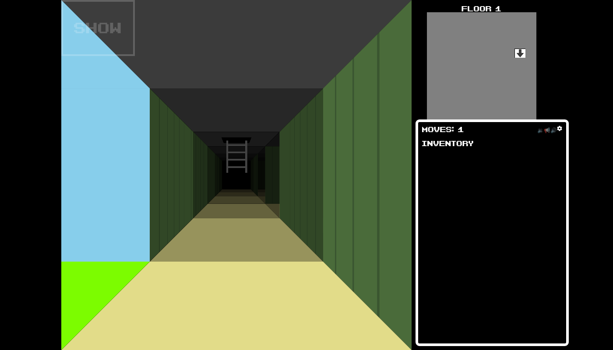

# Randomaze

A seeded random maze generator for multi-floor 3D mazes with keys, locked doors,
ladders and one-way walls, plus the first-person browser UI that plays them.

This is the engine behind the game at [randomazegame.com](https://randomazegame.com).
The same seed always builds the same maze, so everyone can play today's maze, or share a seed.



## Try it

Open `demo/index.html` in a browser. No build step and no server needed.

Add `?type=2&seed=1234` to the address to pick a maze size (0 to 3) and a seed, and `&doors=10`
to add 10 plain (keyless) doors.
Arrow keys walk and turn, Up opens a door you have the key for, and
Page Up / Page Down climb ladders.

Want to make your own game with it? [BUILD-YOUR-OWN.md](BUILD-YOUR-OWN.md) walks you through it,
including how to run a local web server.

## What's here

| Folder | What it is | Needs |
|---|---|---|
| `generator/` | Builds the maze: layout, doors, keys, ladders, one-way walls, and the checks that keep every maze winnable. `mazeplayer.js` holds the rules of play, so a server can replay a game. Plain JavaScript, no DOM. | [seedrandom](https://github.com/davidbau/seedrandom) |
| `ui/` | Draws a maze in 3D with CSS transforms, the map, the inventory, and handles play. `music.js` plays sounds; `title.js` is the colour-cycling title effect. | jQuery (slim is fine), seedrandom, [Font Awesome Free](https://fontawesome.com) icons |
| `demo/` | A complete small game using only the files above. | |
| `test/`, `tools/` | Generator tests, and a checker that builds thousands of mazes looking for crashes and traps. | Node 18+ |

The files are classic browser scripts (no modules). Load them in this order:
`generator/mazeutil.js`, `generator/mazegen.js`, `generator/mazeparams.js`,
`generator/mazeplayer.js`, then
`ui/music.js`, `ui/mazehtml.js`. `demo/index.html` shows the whole setup.

## Using the generator

```js
// Size, floor count, doors and so on all come from one seed.
const params = new MazeParameters(type, seed);   // type 0-3; seed null = today's maze
const maze = new Maze(params.mazeSeed, params.floors, params.columns, params.rows,
	params.doorTypes, params.entrances, params.oneWayWalls);
maze.generateMaze();   // carve the passages
maze.generateDoors();  // add locked doors and hide their keys
maze.generatePlainDoors(10);  // optional: up to 10 doors that need no key
```

`maze.grid[floor][row][column]` is a cell. `cell.data.N`, `S`, `E`, `W`, `U` and `D`
describe each side: `null` is open, `0` is a wall, `1` is a plain door, and `2` or more
is a door that needs key number N. Plain doors (`1`) need no key: the player always holds key 1.
`generatePlainDoors()` uses its own random stream, so it adds doors without moving anything else,
and a maze built without it is unchanged. `cell.data.item.key` is the key lying in that cell.
If a side is open but the neighbour's matching side is not, that is a one-way wall.
`maze.entranceList[0]` is the start and the last entrance is the exit.

`maze.findTraps(startCell, exitCell)` (pass `maze.entranceList[0].cell` and the last entrance's `cell`) reports whether a maze is solvable and whether a player
could get stuck; `generateDoors()` already repairs any maze where they could.

## Checking a finished game

`MazePlayer` in `generator/mazeplayer.js` holds the rules of play: what each action does,
which count as moves, and when keys are picked up. The UI uses it for every key press,
and records each move as one letter: `F` forward or open a door, `B` back, `L`/`R` turn,
`U`/`D` ladder. Bumping into a wall is free and isn't recorded, so the move count is
always the length of that string.

When the player wins, the state passed to the `generateGameUi` callback carries it:
`{state: 'win', moves, cells, actions, times}`, where `times[i]` is when move `i` was
made, in milliseconds since the game began. A server can rebuild the same maze from its
type and seed and replay the game, without trusting the page's move count:

```js
const result = replayGame(maze, actions);
// {valid: true, moves: 57}, or {valid: false, reason: 'action 12 (F) does nothing'}
```

## Using the UI

```js
const mazehtml = new MazeHtml(params.htmlSeed, maze);
mazehtml.assetRoot = '../ui/';   // where ui/img/ is, relative to your page
mazehtml.loadWall({name: 'stone', css: 'background: gray;', tags: ['wall']});
mazehtml.loadDoor({css: 'background: brown;', tags: ['up', 'down', 'left', 'right', 'split']});
mazehtml.loadItem({name: 'Red Key', initials: 'RK', src: 'red.png', invsrc: 'red.png',
	css: '', tags: ['key'], doorcolor: '#FF0000'});
mazehtml.loadClip({url: 'music.mp3', tags: ['maze']});   // optional sounds
mazehtml.generateGameUi('gamewindow', state => { /* menu button, and game over */ });
maze.generateMaze();
maze.generateDoors();
mazehtml.playGame();
```

Load at least `params.doorTypes` key items: a maze never hides more keys than that.
With fewer, the UI reuses items, so two different doors can look alike. The page needs
`ui/css/maze.css` and one inline `<style>` element, which the UI adds its rules to.

## Looks (walls and floors)

Each floor of the maze is cut into regions, and every cell in a region shares one look: a wall
image paired with a floor image. Doors are the borders; a big door-free area is also cut into a few
large regions (`mazehtml.regionSize = {target: 45, min: 12}`, in cells), so the look changes in
places that read as separate areas and never as a small outcrop. It all follows from the maze
and its seed, so everyone sees the same thing, and it never touches the game or replays.

```js
mazehtml.loadWall({name: 'brick', css: '...', tags: ['wall']});
mazehtml.loadWall({name: 'flags', css: '...', tags: ['floor']});
mazehtml.loadLook({wall: 'brick', floor: 'flags'});   // allowed pairs; a wall or floor may be in many
```

Load as many pairs as look good together; neighbouring regions avoid sharing a wall or floor.
With no `loadLook` calls, every wall image goes with every floor image.

Floor and ceiling images are drawn only on cells within `mazehtml.textureRange` steps of the
player (default 1). Farther ground shows the plain `background-color` from the image's css, so
give each floor image its average colour. A phone has little graphics memory, and when it runs out
it drops tiles and even parts of the page; texturing every floor tile in view did exactly that.

## Images

`ui/img/` holds the only images the UI loads by itself: the ladder and the player
marker on the map. They are plain stand-ins; replace the files to give your game its own look.

## Tests

```sh
npm ci
npm test                 # unit tests
npm run check            # build 200 mazes of each type and look for problems
npm run check -- 2000 1  # more mazes, starting at seed 1

npx playwright install chromium   # once, for the browser tests
npm run test:ui          # play the demo in headless Chromium
```

## Releases

A release is a version tag on `main`, like `v0.2.0` ([semantic versioning](https://semver.org):
bump the last number for fixes, the middle one for new features, the first for breaking changes).

```sh
git tag v0.2.0
git push origin v0.2.0
```

Tags with a suffix, like `v0.3.0-beta.1`, are pre-releases. Sites that track the latest
stable release skip them.

## Contributing

Contributions are welcome, from bug reports to new features. See [CONTRIBUTING.md](CONTRIBUTING.md)
for how to get set up and how contributions are used.

## Credits

- **Barcade Brawl** font by zephram, released under CC0 (public domain).
  Included as `ui/css/barcade-brawl.woff`.
- **Font Awesome Free** icons by Fonticons, Inc., loaded from a CDN by the demo, not
  included here. Icons are licensed CC BY 4.0, fonts SIL OFL 1.1, code MIT.
  See <https://fontawesome.com/license/free>.
- **seedrandom** by David Bau (MIT) and **jQuery** (MIT), loaded from a CDN by the demo.

## License

Randomaze is licensed under the **GNU AGPL version 3**, with an exception for code that uses it.
See [LICENSE](LICENSE) and [LICENSE-EXCEPTION.md](LICENSE-EXCEPTION.md). In plain words:

- **Using it:** a game or site that loads these files unchanged and calls them can be under
  any license, closed source included, and does not have to publish its own code.
- **Changing it:** if you modify the files in this repository and run them on a server
  people use, you must offer those people the source of your modified Randomaze files.

Copyright (C) 2024-2026 Michael Wilmes. The art, music and sounds of the Randomaze game
itself are not part of this repository.
